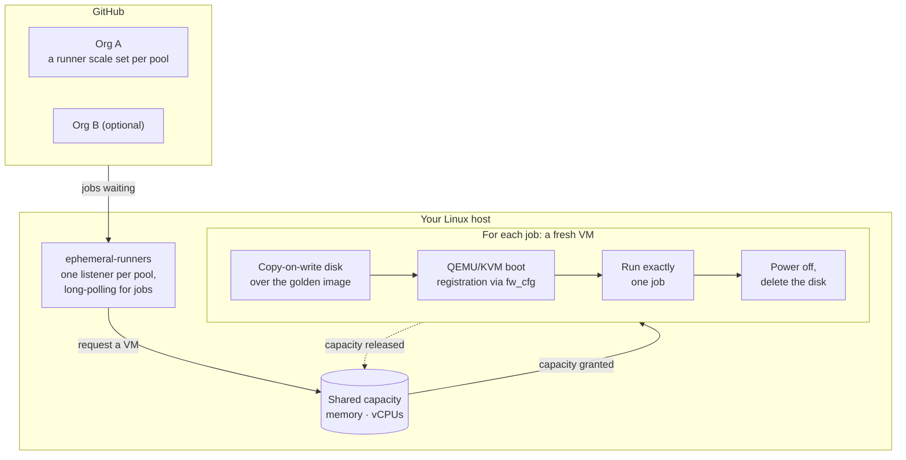

# linux-ephemeral-runners

Self-hosted GitHub Actions runners on a Linux host that behave like
GitHub-hosted ones: every job gets a brand-new QEMU/KVM virtual machine, and
the VM is deleted the moment the job ends. Nothing a job does survives to the
next one, so neither workflows nor runners clean up after themselves.

Runs x86_64 Ubuntu VMs (24.04, like `ubuntu-latest`, and 26.04), as many at
once as the budget you give it allows, on a host that can keep running other
services: jobs can reach the internet and nothing on the host or your network.
Each **deployment** (an org, repo or enterprise the runners serve) is one
config file that you keep outside this repo, plus a GitHub App key that lives
only on the host. One host can serve several deployments, sharing its
capacity between them.

The macOS counterpart is
[macos-ephemeral-runners](https://github.com/KnobanLabs/macos-ephemeral-runners).

> [!WARNING]
> **Experimental.** This runs KnobanLabs' CI, but it has been tested on few
> machines, its CI runs unit tests only, and GitHub's runner scale set API it
> builds on is in public preview. Read the [security model](#security-model)
> before pointing it at anything important. MIT licensed; no warranty.

## How it works



- **Scale sets:** each pool in a deployment is a
  [runner scale set](https://pkg.go.dev/github.com/actions/scaleset). The
  controller is told exactly how many jobs are waiting, and scales from zero,
  so nothing runs while idle. Set `min_idle` to keep warm VMs instead.
- **Golden images:** each pool boots from a golden image, built from Ubuntu's
  official cloud image (checked against Ubuntu's signed checksums) with the
  latest Actions runner, Docker and common build tools. A weekly timer
  rebuilds them, so images carry current security updates and a runner
  version GitHub still accepts. Optionally, they also come with the
  Playwright browsers and container images your jobs pin, so jobs needn't
  download them each time; see [Preloading](#preloading).
- **Single-use VMs:** a job's disk is a copy-on-write overlay on the golden
  image, created in an instant and deleted afterwards. Its just-in-time runner
  registration, valid for one job, reaches the VM through QEMU's firmware
  config device, never over the network. Inside, a systemd unit runs the
  runner and powers the VM off when it exits.
- **Teardown:** a VM is destroyed when GitHub reports its job finished, when
  the VM powers off, or after `job_timeout`, whichever comes first. VMs left
  over from a crash or power loss are deleted on the next start.
- **Capacity:** pools draw from one memory budget and one vCPU budget,
  granted first come, first served, so a big VM isn't starved by small ones.
- **Isolation:** VMs use QEMU's user-mode networking, so they share no network
  with the host or each other, and a firewall limits what they can reach to
  the internet. See the [security model](#security-model).

## Using the runners in a workflow

```yaml
jobs:
  build:
    runs-on: kvm-ubuntu-x64   # a pool name from your deployment's config
```

Jobs run as `runner` with passwordless sudo and Docker, in
`/home/runner/work/<repo>/<repo>`, as on GitHub-hosted runners. `setup-*`
actions work as usual; the images carry far fewer preinstalled tools than
GitHub's, so workflows that rely on one being there without a setup step may
need one added.

**Private repos only.** Don't let public repositories use these runners; see
the [security model](#security-model).

## What lives where

| Thing | Location | In git? |
|---|---|---|
| Controller source, systemd units, firewall, scripts | this repo | yes |
| Deployment configs (org, App IDs, pools) | wherever you keep them; see [Where to keep deployment configs](#where-to-keep-deployment-configs) | not in this repo |
| Installed deployments | `/etc/ephemeral-runners/deployments/<name>.toml` | copies `install.sh` makes |
| Host settings (optional) | `/etc/ephemeral-runners/host.toml`, from `host.example.toml` | no; per host |
| What images preload (optional) | `/etc/ephemeral-runners/preload.toml`, from `preload-config`; see [Preloading](#preloading) | no; per host |
| GitHub App private keys | `/etc/ephemeral-runners/keys/<name>.pem` | **never**; `*.pem` is ignored |
| Controller binary | `/usr/local/bin/ephemeral-runners` | built by `install.sh` |
| systemd units and firewall | `/etc/systemd/system/ephemeral-runners*`, `/etc/systemd/system/nftables.service.d/50-ephemeral-runners.conf`, `/usr/local/share/ephemeral-runners/` (rules and watchdog) | installed by `install.sh` |
| Golden images, VM disks | `/var/lib/ephemeral-runners/images/`, `vms/` | built on the host |
| Logs | `journalctl -u ephemeral-runners` | no |

On GitHub, a deployment is the org's GitHub App plus one runner scale set per
pool. The controller creates the scale sets on first run and reuses them by name
afterwards, so workflows don't change when the host or the maintainer does.

## Setting up a host

### Requirements

- **x86_64 with hardware virtualization** (Intel VT-x or AMD-V) enabled in
  firmware: `/dev/kvm` must exist.
- **Ubuntu 24.04 or later.** Other systemd distributions with QEMU 8.2+ and
  nftables should work, but `install.sh` uses apt.
- **Go**, to build the controller: the version in `go.mod` or later, from
  [go.dev/dl](https://go.dev/dl/) (Ubuntu's packaged Go is too old).
- **Disk:** about 15 GB per golden image, plus what running jobs write.
  Overlays are copy-on-write. [Preloading](#preloading) adds its unpacked
  size to each image, and up to three times that while one is rebuilt (the
  old image, the build's disk and the new image).
- **RAM and CPU:** whatever you budget for VMs (see [Capacity](#capacity)),
  plus what the host's own services need.

### Steps

1. **Get the repo**, somewhere root can read:

   ```bash
   sudo git clone https://github.com/KnobanLabs/linux-ephemeral-runners /opt/linux-ephemeral-runners
   cd /opt/linux-ephemeral-runners
   ```

2. **Set the host's budget** if it runs anything else (recommended), by
   copying `host.example.toml` to `/etc/ephemeral-runners/host.toml` and
   setting `memory_budget_mb` and `vcpu_budget`.

3. **Get a deployment config.** Use your existing one, or copy
   `config.example.toml` to `<name>.toml` outside this repo (`<name>`:
   lowercase letters and digits) and fill in the `YOUR-*` values after
   [creating the GitHub App](#creating-the-github-app).

4. **Give this host its own key for each deployment.** GitHub can't download
   an existing key again, so each host generates its own: on the app's settings
   page, **Private keys → Generate a private key**. Copy it to the host as
   `/etc/ephemeral-runners/keys/<name>.pem`, for example from the machine you
   downloaded it on:

   ```bash
   scp ~/Downloads/<app-slug>.*.private-key.pem root@<host>:/etc/ephemeral-runners/keys/<name>.pem
   ```

5. **Install and start:**

   ```bash
   sudo ./scripts/install.sh path/to/<name>.toml
   ```

   This installs QEMU and the other packages it needs, creates the `ephrunner`
   user, loads the firewall, builds any golden image that's missing (several
   minutes each), and checks everything together (config, keys, images, KVM,
   GitHub access, budget). Only if that passes does it install the config and
   (re)start the service. Pass several configs to install several deployments
   at once.

6. **Verify.** Copy `examples/smoke_test.yaml` into `.github/workflows/` of a
   **private** repo that can use the runners, and run it with your pool names:

   ```bash
   gh workflow run smoke_test.yaml -R <org>/<private-repo> -f pools='["<pool-1>", "<pool-2>"]'
   ```

   It runs 3 jobs per pool, fails if any job sees another's files, and checks
   that jobs can reach the internet but not the host.

### Creating the GitHub App

Once per org, and shared with the org's other runner hosts (the macOS ones
too): each host just gets its own key. The app belongs to the org, not to a
person, so it outlives any one maintainer.

1. Org → Settings → Developer settings → GitHub Apps → **New GitHub App**
   (`https://github.com/organizations/<org>/settings/apps/new`).
   - **Webhook:** uncheck **Active**. The controller polls GitHub, so it needs
     no webhook.
   - **Permissions → Organization → Self-hosted runners:** Read and write.
     Nothing else.
   - **Where can this app be installed:** Only on this account.
2. **Create**, then note the **Client ID**.
3. **Install App** on the org. The installation ID is the number at the end of
   the URL afterwards (`.../settings/installations/<id>`), or:

   ```bash
   gh api orgs/<org>/installations --jq '.installations[] | select(.app_slug=="<app-slug>") | .id'
   ```

4. Put the Client ID and installation ID in your deployment config.

For a single repo or a personal account, set `registration_url` to the repo's
URL and give the app the **Repository → Administration: Read and write**
permission instead.

## Where to keep deployment configs

Deployment configs name your org, its GitHub App and your pools. None of that
is secret, but it's yours, so keep it out of public forks of this repo. Either:

- **Only on the host**, in `/etc/ephemeral-runners/deployments/`. Back that
  folder up (without `keys/`).
- **In a private repo**, for history and review, e.g.
  `deployments/<name>/config.toml`. Its CI can check the configs without a
  host, credentials or images:

  ```yaml
  - uses: actions/setup-go@b7ad1dad31e06c5925ef5d2fc7ad053ef454303e # v7.0.0
    with:
      go-version: stable
  - run: go run github.com/KnobanLabs/linux-ephemeral-runners@develop validate-config deployments/*/config.toml
  ```

## Serving several orgs from one host

```bash
sudo ./scripts/install.sh path/to/acme.toml   # adds acme; deployments already installed stay
```

- **Shared:** the memory and vCPU budgets and the golden images.
- **Separate:** GitHub App, key, pools and `job_timeout`. VM and runner names
  include the deployment (`eph-acme-kvm-ubuntu-x64-1a2b3c4d`), so each org only
  ever sees its own runners.
- **Removing one** stops serving it and deletes its scale sets from GitHub:

  ```bash
  sudo ./scripts/remove-deployment.sh acme
  ```

## Security model

Each job runs in its own VM, which is deleted when the job ends, so jobs can't
leave anything behind for later jobs. That's the same isolation GitHub-hosted
runners give. It is **not** a sandbox for untrusted code, and these are the
limits to know:

- **Public repositories:** anyone can open a pull request from a fork, and its
  workflows can target any runner label. Never let public repos use these
  runners. An org's Default runner group blocks public repos unless you allow
  them; keep it that way.
- **The network:** a VM's traffic leaves the host as its QEMU process's own,
  which runs as `ephrunner`. `packaging/firewall.nft` lets that user reach the
  internet, and refuses everything on loopback, private, link-local, CGNAT
  and multicast ranges: services on the host (including ones bound to
  localhost), your LAN, Docker networks and cloud metadata. DNS goes only to
  the host's resolver. VMs share no network with each other. The controller
  refuses to run if the firewall isn't loaded. The rules live in a table of
  their own, alongside ufw's and Docker's, which touch only their own; but
  anything that flushes the whole ruleset removes it too. nftables.service
  puts it back immediately (Ubuntu's flushes on every start, reload and
  stop), and a watchdog timer checks every minute, restoring the table or,
  failing that, stopping the runners.
- **Inside the VM:** jobs run as `runner` with passwordless sudo, like
  GitHub-hosted runners. The VM's single-use runner registration is readable
  from inside the VM; it is valid only for that one job.
- **On the host:** the controller and its VMs run as `ephrunner`, with no
  capabilities, read-only access to the system, `/dev/kvm` as their only
  device, and write access only to `/var/lib/ephemeral-runners`. QEMU runs
  with its seccomp sandbox. GitHub App keys in `/etc/ephemeral-runners/keys/`
  are readable by root and `ephrunner` only; anyone who can read them can
  register runners for that org.
- **VM names:** at startup the controller deletes every VM directory named
  `<vm_prefix>-*` (`eph-*` by default) in `/var/lib/ephemeral-runners/vms/`.

Report vulnerabilities privately; see [SECURITY.md](SECURITY.md).

## Capacity

Left unset, the budgets come from the host's hardware: memory is total RAM
minus `host_reserved_mb` (8 GB by default), vCPUs are 2 × physical cores. On
a host that also runs other services, set both in `host.toml`.
`ephemeral-runners check` prints the budget in use.

Memory is the budget to be careful with: VMs get what they're given, and a
host that runs out starts killing processes. vCPUs can safely exceed the
host's threads, because CI is bursty (downloads, image pulls, waiting on
tests); when jobs do saturate the CPU they share it, and the service's
`CPUWeight=50` makes them yield to the host's own services, which get twice
their share. If memory does run out, `OOMScoreAdjust=500` makes the kernel
kill a job's VM before anything else; to stop VMs before the host is short at
all, cap the service a little above the budget (each VM's QEMU process needs
a few hundred MB on top of its memory):

```bash
sudo systemctl set-property ephemeral-runners.service MemoryMax=115G
```

GitHub's `ubuntu-latest` VM is 4 vCPUs and 16 GB, which is what the example
pools use. A pool's `max_runners` is an upper bound on top of the budgets, and
jobs beyond what fits wait in GitHub's queue. Image builds (weekly, about 4
vCPUs and 8 GB for a few minutes) run outside the budget at low priority.

## Preloading

Jobs that install Playwright's browsers, or pull the same pinned container
images, download them again in every job, since every VM starts from the
golden image. List them in `/etc/ephemeral-runners/preload.toml`, and every
golden image this host builds comes with them:

- **Playwright:** each version's browsers go in the runner user's
  `~/.cache/ms-playwright`, where Playwright looks by default, so jobs need
  no settings. Their system packages are installed, as
  `playwright install-deps` would install them.
- **Container images:** pulled into the image's Docker, each pinned by digest.

Generate the file from your repositories' own pins rather than copying them
by hand. Run this on any machine with a checkout and Go:

```bash
go run github.com/KnobanLabs/linux-ephemeral-runners@develop preload-config \
  package-lock.json compose.yaml > preload.toml
sudo install -o root -g ephrunner -m 0640 preload.toml /etc/ephemeral-runners/preload.toml
sudo -u ephrunner ephemeral-runners check        # checks it with the rest of the config
sudo systemctl start ephemeral-runners-images    # or wait for the weekly rebuild
```

`preload-config` reads:

- the Playwright version from a `package-lock.json`;
- every `name@sha256:<digest>` image reference from any file you give it.

Edit the result as you like; `preload.example.toml` lists every setting. Run
it again when those pins change.

**A list that falls behind costs time, never correctness.** A job whose pins
differ downloads what it needs, as it would without preloading:

- Playwright reuses a browser only when its revision matches and its download
  completed.
- Docker finds an image locally only under the digest the job asks for.

Each item is best effort. One that fails, or takes over 15 minutes, is left
out of the image. The image service's log
(`journalctl -u ephemeral-runners-images`) and the build log
(`images/<name>.build.log`) say which items were left out.

**Whatever you preload is in every job's VM**, for every deployment on the
host. Preload only public things. The build has no registry credentials, and
nothing it pulls should need any.

## Operating

```bash
journalctl -fu ephemeral-runners                          # controller log
ls /var/lib/ephemeral-runners/vms                         # one directory per live VM
sudo -u ephrunner ephemeral-runners check                 # config, keys, images, KVM, budget
sudo systemctl restart ephemeral-runners                  # restart
sudo systemctl start ephemeral-runners-images             # rebuild images now
sudo ./scripts/install.sh <path/to/deployment.toml>       # add a deployment or apply changes
sudo ./scripts/remove-deployment.sh <name>                # retire one deployment
sudo ./scripts/uninstall.sh [--purge]                     # stop serving everything
```

**Updating:** `git pull` in the repo, then `sudo ./scripts/install.sh`.

**Changing a deployment:** edit its config and rerun `install.sh` with it.

**Changing what images preload:** replace `preload.toml`, then rebuild the
images. New jobs use them once they're built; see [Preloading](#preloading).

**Stopping gracefully:** with `drain_timeout = "0s"` (the default), stopping
the controller destroys running jobs' VMs at once. Raise it in `host.toml` to
let them finish, and keep the unit's `TimeoutStopSec` (180 s) above it.

## License

[MIT](LICENSE). QEMU, Ubuntu, the GitHub Actions runner and the packages in
the images have licences of their own.
